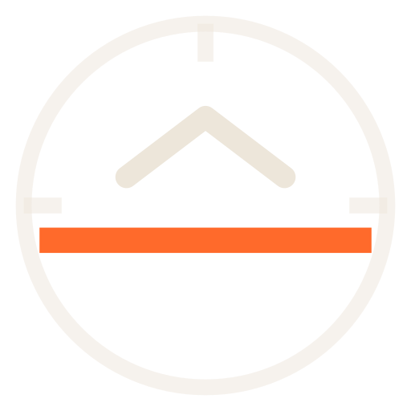
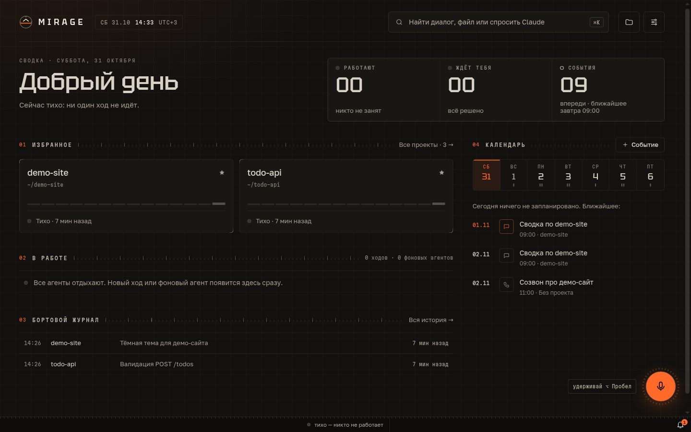
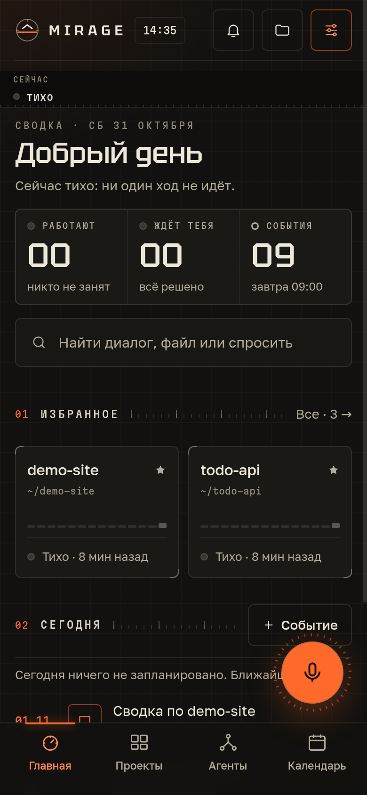
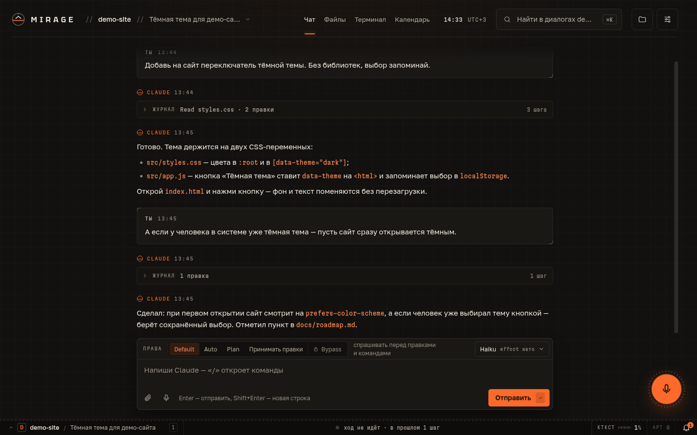
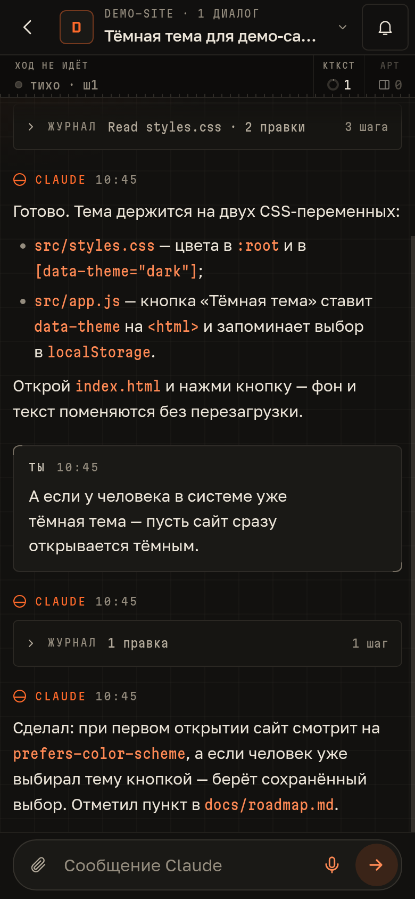
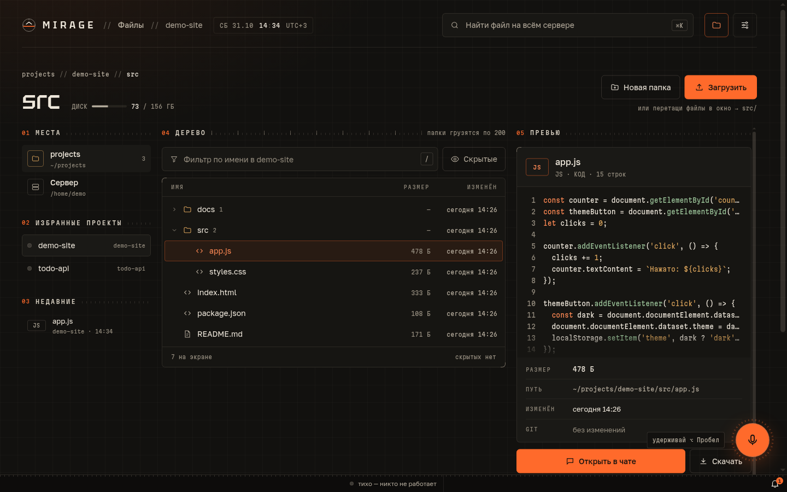
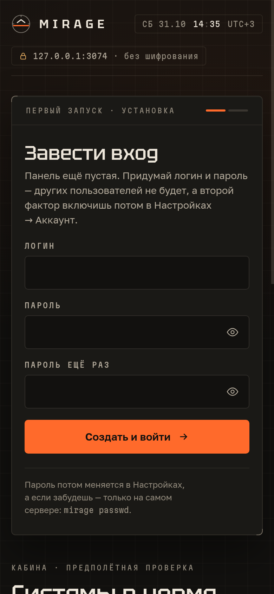
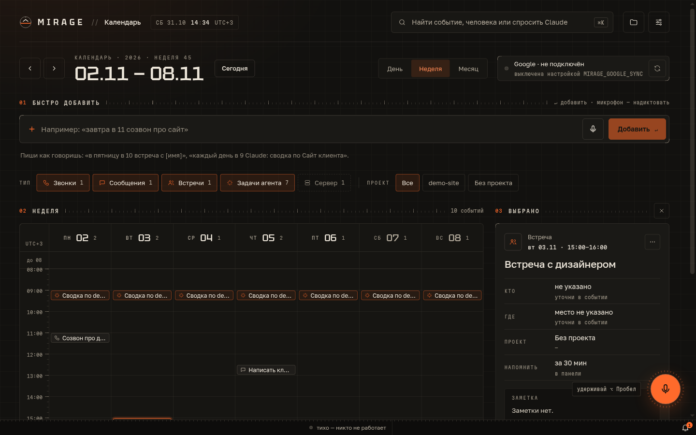

<div align="center">
  
  <h1>Mirage Cloud Panel</h1>
  <p><b>Своя веб-панель для Claude Code на вашем сервере.</b><br>
  Чаты с агентом из браузера и с телефона: вклиниться в идущий ход, остановить, посмотреть агентов, файлы, календарь.</p>
</div>

> **Изменённая версия [CloudCLI UI](https://github.com/siteboon/claudecodeui).**
> Mirage Cloud Panel основана на «CloudCLI UI (https://github.com/siteboon/claudecodeui)» и существенно переработана.
> Это не оригинальный CloudCLI UI и не продукт Siteboon AI B.V. — подробности в [NOTICE](NOTICE) и [лицензии](#лицензия).

**English.** Russian-only UI for now. Mirage Cloud Panel is a self-hosted web panel for
[Claude Code](https://docs.anthropic.com/en/docs/claude-code): chat with the agent from any browser or phone, steer a
running turn, stop it, watch background agents, browse files, plan with a calendar, dictate by voice and get Telegram
notifications. It is a modified version of CloudCLI UI (https://github.com/siteboon/claudecodeui), licensed under
AGPL-3.0-or-later with the additional terms in [LICENSE](LICENSE). Install from source (see below); the package is
not published to npm.

---

## Скриншоты

<table>
  <tr>
    <td width="66%"></td>
    <td width="34%"></td>
  </tr>
  <tr>
    <td></td>
    <td></td>
  </tr>
  <tr>
    <td></td>
    <td></td>
  </tr>
  <tr>
    <td colspan="2"></td>
  </tr>
</table>

<sub>Скриншоты сделаны на демо-данных.</sub>

## Что умеет

- **Чат с Claude Code в браузере** — те же сессии, что в терминале (`~/.claude/projects`), с историей и поиском.
- **Вклинивание в идущий ход** — сообщение уходит Claude, пока он работает, как в терминальном Claude Code; можно
  поставить его в очередь на после хода. **Стоп** обрывает ход, ничего не закрывается случайно.
- **Агенты** — дерево субагентов и фоновых задач, кто сейчас работает и кто ждёт вашего решения.
- **Права** — Default / Auto / Plan / «Принимать правки» / Bypass, запросы разрешений прямо в чате.
- **Файлы** — дерево проекта, превью кода и Markdown, загрузка и скачивание, «спросить Claude про файл».
- **Календарь** — звонки, встречи и отложенные сообщения Claude («каждый день в 9 — сводка по проекту»),
  быстрое добавление обычной фразой; по желанию — синхронизация с Google Calendar.
- **Голос** — удерживаете ⌥ Пробел или кнопку и говорите; распознавание через Yandex SpeechKit или
  OpenAI-совместимый сервер (Whisper).
- **Уведомления** — в браузере и в Telegram: нужно решение, ход закончен, фоновая работа завершилась.
- **Вход** — один владелец, двухфакторная защита (TOTP), список входов, пауза после неудачных попыток.
- Терминал, артефакты Claude, поиск по всему (⌘K), установка как приложение (PWA) на телефон.

Интерфейс «Кабина» — только на русском. Поддержка Codex, Cursor CLI и OpenCode досталась от оригинала;
Mirage проверяется прежде всего с Claude Code.

## Требования

- **Linux или macOS** (сервер, на котором работает Claude Code).
- **Node.js 22 или новее** (`engines` в `package.json`). Для сборки нужен git; если для `node-pty`, `bcrypt`
  и `better-sqlite3` не найдутся готовые сборки — ещё `python3`, `make` и `g++`.
- **Claude Code CLI** установлен и **залогинен под тем же пользователем**, от которого будет работать панель:
  запустите `claude` и выполните `/login` (или задайте `ANTHROPIC_API_KEY` / `CLAUDE_CODE_OAUTH_TOKEN` в `.env`).
  Без входа панель запустится, но первый же ход ответит «Not logged in · Please run /login».

## Установка

```bash
git clone https://github.com/victorglazunoff/mirage-cloud-panel.git
cd mirage-cloud-panel
npm ci --include=dev     # dev-зависимости нужны для сборки, даже если NODE_ENV=production
npm run build
npm run server           # http://127.0.0.1:3001
```

По умолчанию панель слушает только `127.0.0.1:3001` и хранит данные в `~/.mirage`. Порт и адрес меняются в `.env`
(см. [Настройки](#настройки)).

Команда `mirage` (статус, смена пароля, обновление) лежит в `dist-server/server/modules/cli/cli.js`.
Сделать её глобальной — `npm link` в папке панели; без этого вызывайте её так: `npm run mirage -- <команда>`.

```bash
npm link
mirage status            # версия, где база, какие настройки видит сервер
mirage help
```

### Docker

В папке [`docker/`](docker/README.md) — шаблоны [Docker Sandboxes](https://docs.docker.com/ai/sandboxes/): образ
Claude Code (или Codex) с панелью внутри песочницы. Образы собираются из этого репозитория
(`docker build -f docker/claude-code/Dockerfile …`), готовых образов в реестре пока нет. Подробности и команды
`mirage sandbox …` — в [docker/README.md](docker/README.md).

## Первый вход

1. Откройте панель. **Первый посетитель становится владельцем**: придумайте логин и пароль (других пользователей
   не будет). Поэтому не открывайте панель в сеть, пока не зарегистрировались, — см. [Безопасность](#безопасность).
   Если сервер удалённый, зарегистрируйтесь через SSH-туннель: `ssh -L 3001:127.0.0.1:3001 user@server`
   и откройте `http://127.0.0.1:3001` у себя.
2. Мастер первого запуска попросит имя и e-mail для git (`git config --global`) и покажет, вошёл ли Claude Code.
3. Добавьте проект — любую папку на сервере внутри рабочей области (по умолчанию домашняя папка). Проекты, в которых
   вы уже работали с Claude Code в терминале, появятся сами.
4. Включите двухфакторную защиту: **Настройки → Аккаунт**.

**Забыли пароль?** Через интернет его не сбросить — только на сервере, под тем же пользователем, что и панель:

```bash
mirage passwd                       # или: npm run mirage -- passwd
mirage passwd --password-stdin < file-with-password
```

Команда спросит новый пароль дважды (от 12 символов), завершит все входы и снимет блокировку после неудачных
попыток. Двухфакторная защита остаётся. Если данные не в `~/.mirage` — добавьте `--database-path <файл>`.

## Работа за прокси (HTTPS)

Открывать панель в интернет — **только через HTTPS**: внутри пароль, токены и полный доступ к серверу, а микрофон,
push-уведомления и установка на телефон в браузерах работают только на защищённом адресе.
Панель остаётся на `127.0.0.1`, наружу смотрит прокси.

**Caddy** (сертификат получит сам, WebSocket проксирует без настроек):

```caddyfile
panel.example.com {
    reverse_proxy 127.0.0.1:3001
}
```

**nginx:**

```nginx
server {
    listen 443 ssl http2;
    server_name panel.example.com;
    # ssl_certificate / ssl_certificate_key — ваши сертификаты (например, от certbot)

    client_max_body_size 200m;          # загрузка файлов в панель — до 200 МБ

    location / {
        proxy_pass http://127.0.0.1:3001;
        proxy_http_version 1.1;
        proxy_set_header Upgrade $http_upgrade;          # WebSocket: чат и терминал
        proxy_set_header Connection "upgrade";
        proxy_set_header Host $host;
        proxy_set_header X-Forwarded-For $proxy_add_x_forwarded_for;
        proxy_set_header X-Forwarded-Proto $scheme;
        proxy_read_timeout 1d;                            # длинные ходы не рвутся
        proxy_send_timeout 1d;
        proxy_buffering off;
    }
}
```

Панель под префиксом (`https://example.com/ai/`) — шаблон в [docs/nginx-subpath-template.conf](docs/nginx-subpath-template.conf).

**`TRUST_PROXY`.** Адрес клиента (список входов, блокировка подбора пароля) панель берёт из `X-Forwarded-For`
только от прокси на этой же машине. Если прокси на другом хосте — перечислите его адреса:
`TRUST_PROXY=10.0.0.5` или подсеть `10.0.0.0/24`; `HOST` тогда — адрес, который видит прокси.
`TRUST_PROXY=true` (верить всем) — только если порт панели закрыт для всех, кроме прокси.

## Служба systemd

Рекомендуется отдельный пользователь без root: под root Claude Code не разрешает режим **Bypass** (пропуск всех
подтверждений) — панель тогда выключает кнопку и объясняет почему. Обойти можно только признаком песочницы
(`IS_SANDBOX=1`), и делать это стоит лишь в настоящей изоляции (контейнер, отдельная VM).

```bash
sudo useradd --create-home --shell /bin/bash mirage
sudo -iu mirage
git clone https://github.com/victorglazunoff/mirage-cloud-panel.git && cd mirage-cloud-panel
npm ci --include=dev && npm run build
claude          # войти в Claude Code под этим пользователем: /login
```

`/etc/systemd/system/mirage.service`:

```ini
[Unit]
Description=Mirage Cloud Panel
After=network-online.target
Wants=network-online.target

[Service]
User=mirage
WorkingDirectory=/home/mirage/mirage-cloud-panel
Environment=NODE_ENV=production
ExecStart=/usr/bin/npm run server
Restart=on-failure
RestartSec=5

[Install]
WantedBy=multi-user.target
```

```bash
sudo systemctl daemon-reload
sudo systemctl enable --now mirage
journalctl -u mirage -f
```

Перезапуск службы обрывает идущие ходы Claude — перезапускайте, когда никто не работает.

## Настройки

Все настройки необязательны. Скопируйте [`.env.example`](.env.example) в `.env` в папке панели и раскомментируйте
нужное (одна переменная на строку, без кавычек), затем перезапустите панель. Переменные окружения процесса
(например, из `Environment=` в systemd) **важнее** `.env`. Что панель видит на самом деле — `mirage status`.

| Переменная | По умолчанию | Что делает |
|---|---|---|
| `SERVER_PORT` | `3001` | Порт панели (HTTP и WebSocket) |
| `HOST` | `127.0.0.1` | Адрес, который слушает сервер; `0.0.0.0` — все интерфейсы |
| `TRUST_PROXY` | только локальный прокси | Чьему `X-Forwarded-For` верить: список IP/CIDR, `true`, `false` |
| `MIRAGE_DATA_DIR` | `~/.mirage` | Папка данных: база, вложения, артефакты, плагины |
| `DATABASE_PATH` | `<папка данных>/auth.db` | Файл базы SQLite |
| `WORKSPACES_ROOT` | домашняя папка | Проекты и файловый браузер — только внутри этой папки |
| `MIRAGE_TIMEZONE` | пояс сервера | Часовой пояс часов, календаря и напоминаний (IANA, например `Europe/Moscow`) |
| `MIRAGE_TIMEZONE_LABEL` | смещение `UTC+3` | Подпись к времени, например `МСК` |
| `MIRAGE_PANEL_PUBLIC_URL` | — | Внешний адрес панели для ссылок в Telegram |
| `CLAUDE_CLI_PATH` | `claude` | Путь к Claude Code CLI |
| `ANTHROPIC_API_KEY`, `CLAUDE_CODE_OAUTH_TOKEN` | — | Вход в Claude без `claude login` |
| `CLAUDE_SESSION_IDLE_TIMEOUT_MIN` | `30` | Сколько минут фоновая работа живёт после хода |
| `MIRAGE_SUBSCRIPTION_LIMITS` | выкл. | `1` — показывать лимиты подписки (см. ниже) |
| `MIRAGE_TELEGRAM_BOT_TOKEN` | — | Бот для уведомлений в Telegram |
| `MIRAGE_GOOGLE_CREDENTIALS`, `MIRAGE_GOOGLE_CALENDAR_ID` | — | Синхронизация с Google Calendar |
| `YANDEX_SPEECHKIT_API_KEY` | — | Голосовой ввод через Yandex SpeechKit |
| `VOICE_API_BASE_URL`, `VOICE_API_KEY` | — | Голос через OpenAI-совместимый сервер (Whisper/TTS) |
| `JWT_SECRET` | создаётся сам | Секрет подписи входов; хранится в базе |

Полный список с пояснениями — в [`.env.example`](.env.example).

## Интеграции

Все интеграции **выключены по умолчанию** и включаются переменными в `.env`. Без них панель полностью работает,
а соответствующие места честно пишут «не подключено».

### Telegram

1. Создайте бота у [@BotFather](https://t.me/BotFather) и возьмите токен.
2. В `.env`: `MIRAGE_TELEGRAM_BOT_TOKEN=<токен>`, `MIRAGE_TELEGRAM_POLLING=1` и, если панель за прокси,
   `MIRAGE_PANEL_PUBLIC_URL=https://panel.example.com` (для ссылок «открыть в панели»). Перезапустите панель.
3. **Настройки → Уведомления → «Привязать Telegram»**: кнопка откроет чат с ботом с одноразовым кодом
   (действует 15 минут) — нажмите «Старт». Бот отвечает только привязанному чату.
4. Там же выберите, о чём писать: нужно решение, ход закончен, фоновая работа, лимиты.

### Google Calendar

Синхронизация идёт через **сервисный аккаунт** Google — без входа вашим аккаунтом в панели.

1. В [Google Cloud Console](https://console.cloud.google.com/) создайте проект, включите **Google Calendar API**,
   создайте сервисный аккаунт и скачайте его JSON-ключ.
2. В настройках нужного календаря Google (**Доступ для отдельных пользователей**) добавьте e-mail сервисного
   аккаунта (`…@….iam.gserviceaccount.com`) с правом **«Внесение изменений в мероприятия»**.
3. В `.env`: `MIRAGE_GOOGLE_CREDENTIALS=/путь/к/ключу.json` и `MIRAGE_GOOGLE_CALENDAR_ID=<ID календаря>`
   (e-mail владельца или `…@group.calendar.google.com` из настроек календаря). Ключ храните вне папки панели
   и с правами `600`.
4. Перезапустите панель — в календаре появится «Google · подключён». Интервал опроса —
   `MIRAGE_GOOGLE_SYNC_INTERVAL_SEC` (по умолчанию 120 с), выключить не удаляя ключи — `MIRAGE_GOOGLE_SYNC=off`.

Календарь панели также показывает **таймеры systemd** этого сервера («Расписание сервера», только чтение);
их можно скрыть фильтром «Сервер».

### Голос: Yandex SpeechKit

1. В [Yandex Cloud](https://yandex.cloud/ru/docs/speechkit/) создайте сервисный аккаунт с ролью
   `ai.speechkit-stt.user` и API-ключ для него.
2. В `.env`: `YANDEX_SPEECHKIT_API_KEY=<ключ>` или `YANDEX_SPEECHKIT_API_KEY_FILE=/путь/к/файлу` (файл
   перечитывается без перезапуска).
3. **Настройки → Голос**: язык, движок, горячая клавиша (по умолчанию удерживать ⌥ Пробел).

Вместо SpeechKit можно подключить OpenAI-совместимый сервер распознавания (`VOICE_API_BASE_URL`, `VOICE_API_KEY`,
`VOICE_STT_MODEL`). Без ключей кнопка микрофона показывает «Распознавание не подключено» и ничего никуда не шлёт.

### Лимиты подписки Claude

`MIRAGE_SUBSCRIPTION_LIMITS=1` показывает недельный лимит и кредиты подписки (приборная строка, главный экран,
уведомление на 80 %). Панель читает OAuth-токен Claude Code из `~/.claude/.credentials.json` и обращается к
**неофициальному** `/api/oauth/usage` — он может измениться или перестать работать в любой момент, поэтому
по умолчанию счётчик выключен и места под него в интерфейсе нет.

## Обновление

```bash
cd mirage-cloud-panel
git pull --ff-only && npm ci --include=dev && npm run build
sudo systemctl restart mirage
```

`mirage update` проверяет [релизы на GitHub](https://github.com/victorglazunoff/mirage-cloud-panel/releases)
и напоминает эти команды. База и настройки живут вне папки панели (`~/.mirage`, `.env`) и обновлением не трогаются;
перед крупным обновлением сделайте копию `~/.mirage/auth.db`.

## Переход с CloudCLI UI

Mirage читает данные оригинального CloudCLI UI:

1. Остановите службу CloudCLI UI (у обеих панелей порт по умолчанию — 3001).
2. Установите Mirage под тем же пользователем и запустите. При **первом** запуске, если `~/.mirage` ещё нет,
   а есть `~/.cloudcli` и/или `~/.claude-code-ui`, их содержимое **копируется** в `~/.mirage`: база с пользователем
   и проектами, плагины, настройки. Старые папки не удаляются — к CloudCLI UI можно вернуться.
3. Старые имена переменных `CLOUDCLI_BROWSER_USE_*` читаются как запасные; новые — в `.env.example`.

Если `~/.mirage` уже создан, копирование не повторяется: удалите его (когда панель остановлена) и запустите снова,
либо укажите старую базу через `DATABASE_PATH`.

## Безопасность

- **Первый посетитель становится владельцем.** Пока владельца нет, не открывайте порт в сеть: по умолчанию панель
  слушает только `127.0.0.1` — регистрируйтесь через SSH-туннель или до настройки прокси.
- Панель — это **полный доступ к серверу** от имени её пользователя: терминал, файлы, команды Claude. Запускайте её
  под отдельным пользователем, ограничьте `WORKSPACES_ROOT`, держите наружу только HTTPS.
- Включите **2FA** (TOTP, Настройки → Аккаунт) и сохраните резервные коды. После 5 неверных паролей вход по этому
  имени замирает на 15 минут; вход живёт 30 дней, лишние входы закрываются в настройках.
- Ключи интеграций держите в `.env` или в файлах с правами `600`, не в репозитории.
- Нашли уязвимость — [SECURITY.md](SECURITY.md).

## Разработка

```bash
npm ci --include=dev
npm run dev                       # сервер + Vite на http://localhost:5173
npm test                          # тесты сервера
NODE_ENV=test npx vitest run src  # тесты интерфейса
npm run typecheck
```

Правила кода — [AGENTS.md](AGENTS.md) и [CONTRIBUTING.md](CONTRIBUTING.md); устройство чата и потока событий —
[docs/architecture](docs/architecture/README.md).

## Лицензия

[GNU AGPL-3.0-or-later](LICENSE) с дополнительными условиями по разделу 7 (в конце `LICENSE`), см. также [NOTICE](NOTICE).

Mirage Cloud Panel — **изменённая версия** «CloudCLI UI (https://github.com/siteboon/claudecodeui)»,
© Siteboon AI B.V. и участники. Имена CloudCLI и Siteboon используются только для указания происхождения;
проект не связан с Siteboon AI B.V. и не одобрен ею.

Если вы запускаете изменённую панель для других людей по сети, AGPL требует дать им исходный код этой версии —
ссылка на исходники уже есть в подвале экрана входа и в «Настройки → Ещё → О панели».
